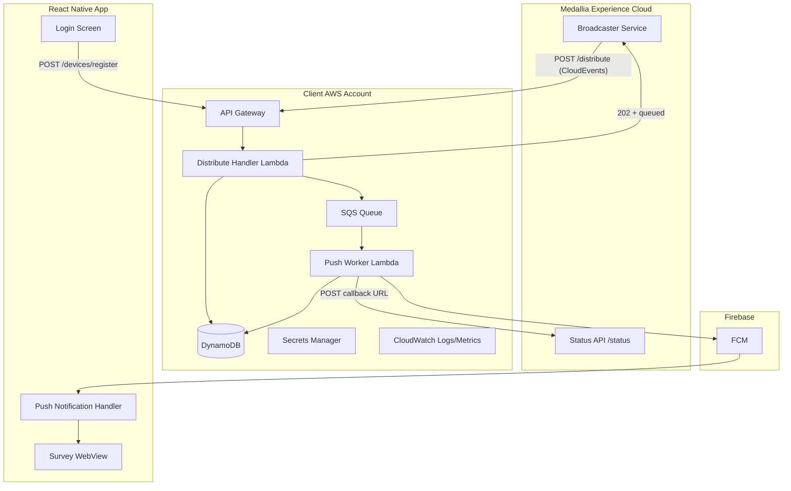
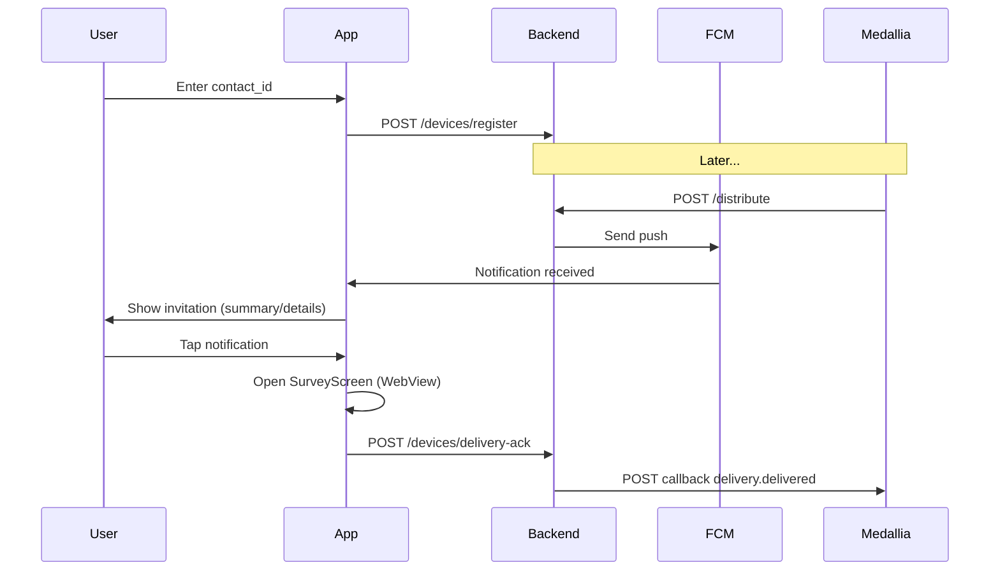

# Distribution Webhook Mobile Reference Implementation

## Context

Medallia Experience Cloud publishes survey invitations to a client-owned `POST /distribute` endpoint as [CloudEvents 1.0](https://cloudevents.io/) JSON (`application/cloudevents+json`). The client webhook must:

1. Authenticate inbound requests (Basic Auth)
2. Handle auth-check probes (`com.medallia.survey.invitation.authcheck`)
3. Accept distribution requests (`com.medallia.survey.invitation`) containing `contact_id`, `survey_url`, localized `messages`, and a Medallia `callback` URL
4. Return synchronous status CloudEvents (`delivery.queued|sent|failed|...`) and/or accept async processing (`202`)
5. POST delivery status updates to the Medallia `callback` URL (Status API)

This repo ([`/Users/cverges/Desktop/webhook-test-app`](/Users/cverges/Desktop/webhook-test-app)) is **empty** — full greenfield. All code will be open-source friendly (no Medallia proprietary libraries); only public API contract types and HTTP calls to documented endpoints.

**User decisions incorporated:**
- React Native mobile app
- Simple in-app `contact_id` login → device token registration
- Node.js (TypeScript) Lambda backend
- HTTP Basic Auth for inbound webhook only
- Production patterns: idempotency, async 202, status callbacks, error handling, observability

---

## High-Level Architecture



---

## Repository Layout

```
webhook-test-app/
├── README.md                          # Overview, quickstart, architecture link
├── docs/
│   ├── architecture.md                # Diagrams, data flows, status lifecycle
│   ├── setup.md                       # AWS, Firebase, Medallia config steps
│   ├── features/0001_PLAN.md          # This plan (persisted on implementation)
│   └── api/                           # Copy of reference OpenAPI specs
│       ├── distribute-v1_0_0.yaml
│       └── status-v1_0_0.yaml
├── infra/terraform/                   # All AWS resources
├── backend/                           # TypeScript Lambda functions
├── mobile/                            # React Native app
├── scripts/                           # Local test webhook sender, seed data
└── .github/workflows/                 # CI: lint, test, terraform validate
```

---

## Phase 1 — Shared Data Model and API Contracts

Define TypeScript types mirroring the OpenAPI schemas (no code generation dependency required; hand-written types with JSDoc referencing the spec fields):

| Type | Source schema | Key fields |
|------|---------------|------------|
| `DistributionRequest` | distribute YAML | `id`, `traceparent`, `data.contact_id`, `data.survey_url`, `data.messages[]`, `data.callback`, `data.expiration_timestamp`, `data.record_type` |
| `AuthCheckRequest/Response` | distribute YAML | auth probe handling |
| `DistributionUpdate` | both YAML | `type` enum: `delivery.queued\|sent\|failed\|delivered\|optout` |
| `DistributionUpdateResponse` | status YAML | Medallia ack: `updatesuccess\|updateerror` |

**Internal models** (not in Medallia spec):
- `DeviceRegistration`: `{ contactId, fcmToken, platform, locale?, updatedAt }`
- `ProcessedMessage`: `{ messageId, status, processedAt }` for idempotency

**Locale resolution algorithm** (document in code):
1. Match `data.preferred_locale` against `data.messages[].locale`
2. Fall back to first available message
3. Fall back to generic English defaults (`"We'd love your feedback"`)

---

## Phase 2 — AWS Infrastructure (Terraform)

All resources in [`infra/terraform/`](infra/terraform/) with environment-specific `tfvars` examples.

| Resource | Purpose |
|----------|---------|
| **API Gateway (HTTP API)** | Public HTTPS endpoints |
| **Lambda: `distribute-handler`** | `POST /distribute` — auth, validation, idempotency, enqueue |
| **Lambda: `push-worker`** | SQS consumer — FCM send + Medallia status callbacks |
| **Lambda: `device-register`** | `POST /devices/register` — mobile token registration |
| **SQS + DLQ** | Async processing for 202 flow; failed jobs after retries |
| **DynamoDB: `devices`** | PK=`contactId`, stores FCM token + metadata |
| **DynamoDB: `messages`** | PK=`messageId`, TTL-enabled idempotency + audit trail |
| **Secrets Manager** | Webhook Basic Auth credentials, FCM service account JSON, Medallia outbound API credentials |
| **IAM roles** | Least-privilege per Lambda |
| **CloudWatch** | Log groups, custom metrics (push success/fail, callback latency), optional alarms |

**Endpoints:**

| Method | Path | Handler | Auth |
|--------|------|---------|------|
| POST | `/distribute` | distribute-handler | Basic Auth (API Gateway authorizer or Lambda-level validation) |
| POST | `/devices/register` | device-register | API key or lightweight JWT (document as client-configurable; default: API key in app config) |

**Terraform outputs:** API base URL, example curl commands, DynamoDB table names.

---

## Phase 3 — Backend (TypeScript / Lambda)

Location: [`backend/`](backend/)

### 3A — Distribute Handler (`POST /distribute`)

**Step-by-step processing:**

1. **Authenticate** — validate `Authorization: Basic ...` against Secrets Manager value; return `401` on failure
2. **Parse** — require `Content-Type: application/cloudevents+json`; validate CloudEvents envelope
3. **Route by `type`:**
   - `com.medallia.survey.invitation.authcheck` → return `200` with `AuthCheckResponse` (`authcheck.success` or `.error`)
   - `com.medallia.survey.invitation` → continue below
4. **Idempotency** — if `data.id` exists in `messages` table, return prior `DistributionUpdate` (same status)
5. **Validate business rules:**
   - Reject expired invitations (`expiration_timestamp < now`) → `delivery.failed` (non-retryable)
   - Log `record_type` (`live` vs `preview`) for observability
6. **Async accept (202 pattern):**
   - Persist `delivery.queued` record
   - Enqueue `{ messageId, traceparent, distributionPayload }` to SQS
   - Return `202` with `DistributionUpdate` type `delivery.queued`
7. **Rate-limit headers** — pass through or set static demo values per spec (`X-RateLimit-*`)

### 3B — Push Worker (SQS-triggered)

1. Load `contact_id` from payload → query `devices` table
2. **No device registered** → POST `delivery.failed` to `data.callback` with `retryable: true`, error code `DEVICE_NOT_REGISTERED`
3. **FCM send** — push notification payload:
   ```json
   {
     "notification": { "title": "<summary>", "body": "<details>" },
     "data": { "surveyUrl", "messageId", "surveyId", "expirationTimestamp" }
   }
   ```
4. **FCM success** → POST `delivery.sent` to Medallia callback
5. **FCM failure** → POST `delivery.failed` with `retryable` based on FCM error class; SQS retry with backoff for retryable errors
6. **Callback client** — HTTP POST to `data.callback` with `DistributionUpdate` CloudEvent; authenticate with Medallia API credentials from Secrets Manager (OAuth client credentials — document setup; no Medallia SDK)

### 3C — Device Register Handler (`POST /devices/register`)

1. Accept `{ contactId, fcmToken, platform, locale? }`
2. Upsert into `devices` DynamoDB table
3. Return `200` with registration confirmation

Used by mobile app after user enters their `contact_id` on login screen.

### 3D — Delivered Status (optional endpoint or app-triggered)

When user taps notification and opens survey:
- Mobile app calls `POST /devices/delivery-ack` with `{ messageId }`
- Backend POSTs `delivery.delivered` to Medallia callback URL (stored with idempotency record or passed from push data)

Store `callback` URL and `traceparent` in the idempotency record at enqueue time so delivered acks can be sent without re-fetching.

### 3E — Observability and Error Handling

- Structured JSON logging with `messageId`, `traceparent`, `contactId`
- CloudWatch metrics: `InvitationsQueued`, `PushSent`, `PushFailed`, `CallbackErrors`
- DLQ monitoring alarm
- Unit tests for CloudEvent parsing, locale fallback, idempotency
- Integration test with mocked FCM and Medallia callback (local or CI)

---

## Phase 4 — Mobile App (React Native)

Location: [`mobile/`](mobile/)

**Stack:** React Native (Expo or bare RN — recommend **Expo** for easier reference setup with `@react-native-firebase/messaging` or `expo-notifications` + FCM)

### Screens and Flows

1. **LoginScreen** — user enters `contact_id` (email, loyalty ID, etc.); persisted locally (AsyncStorage)
2. **HomeScreen** — shows registered contact_id, registration status, last invitation received
3. **SurveyScreen** — in-app WebView loading `survey_url` from push data

### Push Notification Flow



### Key implementation details

- Request notification permissions on first launch
- Register FCM token on login and on token refresh
- **Foreground handler** — display in-app banner if notification arrives while app is open
- **Background/killed handler** — standard OS notification; deep link to SurveyScreen
- Parse localized message from push `data` payload (backend resolves locale before send)
- Config via `app.config.js` / `.env`: `API_BASE_URL`, `API_KEY`

---

## Phase 5 — Documentation and Developer Experience

### README sections
- Architecture overview (link to `docs/architecture.md`)
- Prerequisites: AWS account, Firebase project, Medallia tenant with Distribution Webhook enabled
- Deploy: `terraform apply` → configure Medallia webhook URL + Basic Auth
- Run mobile app locally
- Send test webhook: [`scripts/send-test-webhook.sh`](scripts/send-test-webhook.sh)

### `docs/setup.md` checklist
1. Create Firebase project → download service account JSON → store in Secrets Manager
2. Deploy Terraform → note API Gateway URL
3. Configure Medallia webhook: URL = `{api_url}/distribute`, auth = Basic
4. Run auth-check from Medallia admin UI
5. Install mobile app → register contact_id matching a Medallia test contact
6. Trigger test distribution → verify push + status callbacks in CloudWatch

### `docs/architecture.md`
- Status lifecycle diagram (`queued → sent → delivered | failed`)
- Idempotency behavior
- Retry policy table
- Security notes (secrets rotation, HTTPS-only, no PII in logs)

---

## Status Callback Lifecycle

| Event | Trigger | Medallia `type` |
|-------|---------|-----------------|
| Webhook accepted | Distribute handler enqueues | `delivery.queued` (202 response) |
| Push dispatched | FCM accepts message | `delivery.sent` |
| User opens survey | Mobile delivery-ack | `delivery.delivered` |
| No device / FCM error | Worker failure | `delivery.failed` |
| User opts out | Future app feature | `delivery.optout` |

Each outbound callback is a CloudEvent POST to the `callback` URL from the original `DistributionRequest`, authenticated per Medallia tenant API credentials (documented in setup guide — not implemented as a proprietary library).

---

## Security Considerations

- Basic Auth credentials generated by Terraform (`random_password`) → stored in Secrets Manager; never committed
- FCM service account JSON in Secrets Manager only
- Device registration endpoint protected by API key (reference default; document upgrade path to Cognito JWT)
- Validate all inbound CloudEvent required fields before processing
- Do not log full `survey_url` or `contact_id` in production mode (configurable log redaction)
- HTTPS enforced via API Gateway

---

## Testing Strategy

| Layer | Approach |
|-------|----------|
| Unit | CloudEvent parsing, auth validation, locale fallback, idempotency |
| Integration | Mock FCM + mock Medallia callback HTTP server in CI |
| Manual E2E | Script sends sample `DistributionRequest` → verify DynamoDB + push on device |
| Terraform | `terraform validate` + optional `tflint` in CI |

Sample test fixtures in [`backend/tests/fixtures/`](backend/tests/fixtures/) derived from OpenAPI examples (using generic example.com URLs, not real Medallia tenant data).

---

## Out of Scope (document as extension points)

- OAuth inbound webhook auth (user chose Basic only; note how to extend)
- Multi-device per contact_id (v1: last registration wins)
- Opt-out UI (`delivery.optout`)
- Real identity provider integration (Cognito/Auth0)
- APNS direct integration (FCM handles iOS transport via Firebase APNs config)
- Medallia proprietary SDKs or internal libraries

---

## Implementation Order

Work proceeds sequentially; backend and mobile can parallelize after Phase 1 types are defined:

1. Scaffold repo structure, copy OpenAPI specs, README skeleton
2. Terraform infra (API Gateway, DynamoDB, SQS, Secrets, Lambdas placeholder)
3. Backend: types → distribute handler → device register → push worker → status callback client
4. Mobile: login + FCM registration → notification display → survey WebView → delivery ack
5. Scripts, docs, CI, end-to-end manual test guide
